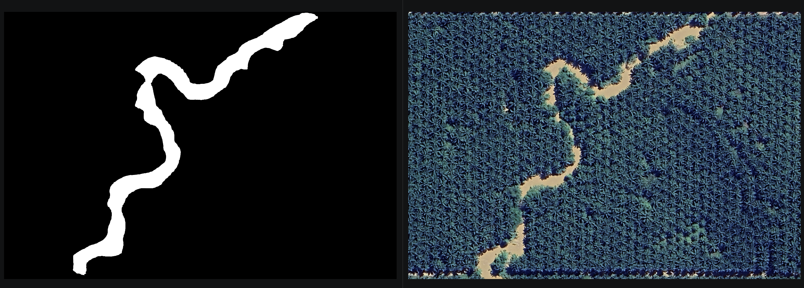

# UNet River & Road Segmentation



A compact pipeline for binary and multilabel segmentation of rivers, roads, and other features using a UNet-style model. It includes tools to convert GeoJSON and AnyLabeling annotations to masks, dataset loading utilities, training and inference scripts, and example data. The model uses the UNet architecture from [Segmentation Models PyTorch](https://github.com/qubvel-org/segmentation_models.pytorch).

**Features**
- Convert GeoJSON and AnyLabel exports into segmentation masks.
- Binary segmentation with one model per target class, or multilabel segmentation with one independent output channel per class.
- UNet model implementation, training loop, and prediction script.
- Example annotations, generated datasets, and trained model checkpoints.

**Repository layout**
- `Annotation_Data_Collection/Anylabeling_format/` — AnyLabeling images and matching JSON annotations.
- `Annotation_Data_Collection/Geojson_format/` — Class subfolders containing matching GeoTIFF/GeoJSON pairs.
- `dataset_conversion/anylabeling_to_mask.py` — Convert AnyLabeling annotations to binary or multilabel datasets.
- `dataset_conversion/geojson_to_mask.py` — Convert GeoJSON annotations to binary or multilabel datasets.
- `create_dataset_test.py` — Example converter configuration for the included annotations.
- `model.py` — UNet model architecture and helpers.
- `train.py` — Training, evaluation, and checkpoint-loading functions.
- `predict.py` — Inference function and mask export.
- `dataset_loader.py` — Dataset and dataloader utilities.
- `test_river.py`, `test_road.py`, `test_multilabel.py` — Example training and prediction scripts.
- `Datasets/` — Generated datasets (local working data).
- `Model/` — Example trained checkpoints and learning curves.
- `Test Image/` — Example images and prediction outputs.
- `environtment_conda.yml` — Conda environment spec (recommended).
- `requirements.txt` — Python dependencies for pip installs.

Requirements
- Python 3.8+ recommended.
- Common Python packages listed in `requirements.txt`.
- Optional: use `conda` to install GDAL/rasterio binaries on Windows for easier setup.

Installation
1. (Recommended) Create and activate the conda environment:

	 conda env create -f environtment_conda.yml -n unet-seg
	 conda activate unet-seg

2. Or install packages with pip:

	 pip install -r requirements.txt

Prepare your data
- **AnyLabeling:** place each image beside its matching same-basename `.json` annotation in one input folder. The JSON `shapes` labels identify the classes. A single image can contain shapes from multiple classes.

  ```text
  Annotation_Data_Collection/
  └── Anylabeling_format/
      └── building_tree/
          ├── 1.jpg
          ├── 1.json
          ├── 2.jpg
          └── 2.json
  ```

- **GeoJSON:** create one subfolder per class. Each scene must have a same-basename GeoTIFF and GeoJSON pair in its class folder. Class names come from the folder names; `classes.txt` is not needed.

  ```text
  Annotation_Data_Collection/
  └── Geojson_format/
      └── river_road/
          ├── river/
          │   ├── scene_01.tif
          │   └── scene_01.geojson
          └── road/
              ├── scene_02.tif
              └── scene_02.geojson
  ```

- For binary conversion, each class dataset is generated separately (background versus that class). For multilabel conversion, one model predicts all classes independently. A multilabel dataset requires complete annotations: every scene must explicitly represent all classes, including empty annotations where a class is absent.
- Both converters create datasets with `images/`, `labels/`, and `train/`, `val/`, `test/` splits. Multilabel datasets also include a `classes.json` file that defines the mask-band order. Keep that metadata with the dataset and use it when loading the matching model.

Convert annotations to masks
- Use `dataset_conversion/geojson_to_mask.py` for GeoJSON; it rasterizes vector annotations into masks aligned with the source imagery.
- Use `dataset_conversion/anylabeling_to_mask.py` to convert AnyLabeling JSON annotations into masks.
- AnyLabeling conversion supports `multilabel=True` to save each input image once and a multi-band TIFF mask with one band per class. The channel-to-class ordering is saved in `classes.json`:

```python
from dataset_conversion.anylabeling_to_mask import batch_generate_datasets_from_anylabeling

batch_generate_datasets_from_anylabeling(
    input_dir="Annotation_Data_Collection/Anylabeling_format",
    output_dir="Datasets/Multilabel",
    multilabel=True,
    is_augmented=True,
    num_augmented=5,
)
```

- In multilabel mode, an absent shape for a class becomes an empty mask for that class, so use it only when each image is exhaustively annotated for every class.
- GeoJSON input folders can contain one subfolder per class (for example, `river/` and `road/`); output mirrors the AnyLabeling layout, with a separate dataset under `output/<class>/` and its own `images/`, `labels/`, `train/`, `val/`, and `test/` directories.
- GeoJSON conversion also supports `multilabel=True` to combine all class folders into one dataset with a multi-band TIFF mask (one band per class), recorded in `classes.json`. Channel indexes are zero-based; GeoTIFF band numbers are one-based, and each band is named for its class:

```python
from dataset_conversion.geojson_to_mask import batch_generate_datasets_from_geojson

batch_generate_datasets_from_geojson(
    input_folder="Annotation_Data_Collection/Geojson_format/river_road",
    output_dir="Datasets/River_Road_Multilabel",
    multilabel=True,
    is_augmented=True,
    num_augmented=5,
)
```

- In GeoJSON multilabel mode, each scene must have matching TIFF/GeoJSON files in every class folder. Use an empty GeoJSON to explicitly mark a class absent from a scene. All class rasters for a scene must use the same grid.
- Dataset splitting checks that each image has a matching mask, keeps augmented variants in the same split, and applies augmentation to training data only.

Generated dataset layout:

```text
Datasets/
└── River_Road_Multilabel/
    ├── classes.json
    ├── images/
    ├── labels/
    ├── train/
    │   ├── images/
    │   └── labels/
    ├── val/
    │   ├── images/
    │   └── labels/
    └── test/
        ├── images/
        └── labels/
```

Binary conversion instead creates one dataset per class, with the same split structure under each class directory.

Training
- Use `run_training_for_classes` to train every generated class dataset or select specific classes. Each class gets a separate checkpoint and learning curve:

```python
from train import run_training_for_classes

# Train all classes found under the generated dataset root
run_training_for_classes(
    dataset_root="Datasets/River_Road_Dataset",
    class_names="all",
    num_epochs=50,
    batch_size=4,
    save_path="models/best.pth",
)

# Train only one class
run_training_for_classes(
    dataset_root="Datasets/River_Road_Dataset",
    class_names="river",
    num_epochs=50,
    batch_size=4,
    save_path="models/best.pth",
)
```

The resulting checkpoints are named `best_river.pth`, `best_road.pth`, and so on. The existing `run_training(dataset_dir=...)` still trains one dataset folder directly.

The `test_river.py`, `test_road.py`, and `test_multilabel.py` scripts use a `train_model` flag to choose whether to train before prediction. Set `train_model = False` to skip training and load an existing checkpoint; set it to `True` to train first. The current scripts set this flag to `True`. If training is skipped, make sure the checkpoint at `save_path` exists. Default checkpoint paths are:

- River: `Model/Singlelabel/unet_river_river.pth`
- Road: `Model/Singlelabel/unet_road_road.pth`
- Multilabel: `Model/Multilabel/unet_building_tree.pth`

The river and road scripts read input images from `Test Image/river_road`; the multilabel script reads from `Test Image/building_tree`. Change these paths in the scripts to match your files.

To train one multilabel model from either converter's multi-band dataset, enable multilabel mode. The model output channels are read from `classes.json`:

```python
from train import run_training

run_training(
    dataset_dir="Datasets/River_Road_Multilabel",
    multilabel=True,
    num_epochs=50,
    batch_size=4,
    save_path="models/river_road_multilabel.pth",
)
```

Multilabel validation and test reports include macro metrics and per-class metrics. For inference, initialize the model with the same class count and pass the class names; save the multi-channel mask as GeoTIFF:

```python
from model import get_model
from predict import predict
import json
import torch

with open("Datasets/River_Road_Multilabel/classes.json", encoding="utf-8") as file:
    metadata = json.load(file)
class_mapping = metadata.get("class_to_channel", metadata)
class_names = [
    name for name, _ in sorted(class_mapping.items(), key=lambda item: item[1])
]
model = get_model(num_classes=len(class_names))
checkpoint = torch.load("models/river_road_multilabel.pth", map_location="cpu")
model.load_state_dict(checkpoint["model_state_dict"])
predict(
    model,
    image_path="path/to/image.tif",
    device=torch.device("cpu"),
    save_path="predictions/classes.tif",
    multilabel=True,
    class_names=class_names,
)
```

- Training reports validation Dice, IoU, precision, and recall each epoch. If a non-empty `test` split is available, it reports held-out test metrics once using the best validation-loss checkpoint.
- Validation and test transforms are deterministic; training transforms may augment images.
- Splits group files sharing an original stem, including variants named `_aug_<number>`. For reliable geographic evaluation, organize or assign source scenes to spatial groups before splitting; random splitting of nearby, unaugmented scenes can still overstate generalization.

Inference
- The `test_river.py` and `test_road.py` examples save one binary mask per image as `<image_name>_predicted_mask.tif`.
- The `test_multilabel.py` example saves one multiband GeoTIFF per image as `<image_name>_predicted_mask.tif`. Each band represents a class in `classes.json`, and the band descriptions contain the class names.
- Prediction TIFFs are saved beside their input images. If an input is a GeoTIFF, the output retains its CRS and affine transform. Non-georeferenced inputs produce TIFF masks without CRS information.
- `predict.py` exposes a Python function rather than the command-line interface shown in older examples. Use `predict(...)` directly or run one of the `test_*.py` scripts.

Testing
- The `test_river.py`, `test_road.py`, and `test_multilabel.py` scripts are runnable training/inference examples. Set `train_model = False` to run inference only with a saved checkpoint.

Notes & troubleshooting
- On Windows, prefer `conda` to install `gdal` / `rasterio` to avoid build issues.
- Train each class-specific model using its corresponding generated class folder.

Contributing
- Contributions are welcome: suggested improvements include clearer CLI docs, evaluation scripts (IoU/F1), and visualization utilities.
